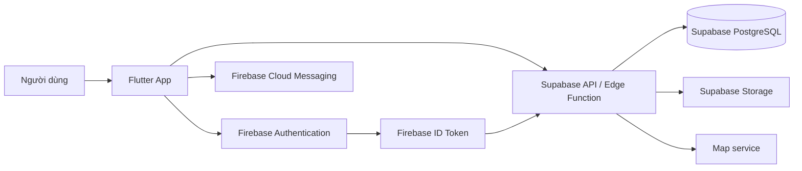

# Thực hành 2: Phát triển Hệ thống Quản lý Tài liệu Đa nền tảng

## 1. Mục tiêu và phạm vi

Xây dựng ứng dụng quản lý tài liệu học tập đa nền tảng bằng Flutter, kết hợp
Firebase và Supabase. Hệ thống hỗ trợ lưu trữ tài liệu, gắn thẻ, quản lý vị trí
vật lý, chia sẻ/mượn tài liệu và gợi ý tài liệu phù hợp với sở thích của người
dùng.

Các nền tảng mục tiêu gồm Android, iOS và Web. Giao diện được thiết kế
responsive để sử dụng thuận tiện trên điện thoại, máy tính bảng và trình duyệt.

## 2. Checklist triển khai

| STT | Hạng mục | Nội dung chính |
|---:|---|---|
| 1 | Kiến trúc và mô hình dữ liệu | Firebase Authentication/Messaging kết hợp Supabase Database/Storage |
| 2 | Giao diện đa nền tảng | Xây dựng giao diện Flutter responsive cho Mobile và Web |
| 3 | Tag và vị trí | Phân loại bằng tag và lưu vị trí vật lý trên bản đồ |
| 4 | Chia sẻ và mượn tài liệu | Gửi yêu cầu, phê duyệt/từ chối và cấp quyền truy cập |
| 5 | Recommendation | Gợi ý tài liệu dựa trên tag và lịch sử tương tác |
| 6 | Kiểm thử và đóng gói | Kiểm thử chức năng, phân quyền và phát hành ứng dụng |


## 3. Phân chia nhiệm vụ

| Checklist | Người phụ trách | Đầu việc |
|---:|---|--|---|
| 1. Kiến trúc và mô hình dữ liệu | **Lục Văn Thuận (Nhóm trưởng)** | Thiết kế kiến trúc Firebase/Supabase, database, RLS và quy ước tích hợp |
| 2. Giao diện đa nền tảng | Nguyễn Khắc Minh Hiếu | Xây dựng giao diện Flutter responsive cho Mobile/Web, đăng nhập, danh sách và biểu mẫu |
| 3. Tag và vị trí |  Nguyễn Khắc Minh Hiếu | Phát triển tag, tìm kiếm/lọc, bản đồ và quản lý vị trí vật lý | 
| 4. Chia sẻ và mượn tài liệu | Trần Văn Hồng Quân |Xây dựng luồng chia sẻ, gửi yêu cầu mượn, phê duyệt, từ chối và thu hồi quyền |
| 5. Recommendation | Hoàng Tùng | Xây dựng thuật toán gợi ý theo tag/lịch sử tương tác và tích hợp thông báo FCM |
| 6. Kiểm thử và đóng gói | Lục Văn Thuận  | Viết kịch bản kiểm thử, kiểm thử đa nền tảng, sửa lỗi và tạo bản release |

### Thông tin thành viên

| Thành viên | Mã sinh viên | Vai trò |
|---|---:|---|
| **Lục Văn Thuận** | **2351170624** | **Nhóm trưởng** |
| Nguyễn Khắc Minh Hiếu | 225116000 | Thành viên |
| Trần Văn Hồng Quân | 2351170613 | Thành viên |
| Hoàng Tùng | 2351170630 | Thành viên |

### Nguyên tắc phối hợp

- Mỗi thành viên phát triển trên một nhánh riêng và mô tả rõ thay đổi trong
  pull request.
- Nhóm trưởng Lục Văn Thuận chịu trách nhiệm kiểm tra, giải quyết xung đột và
  **gộp nhánh code** vào nhánh chính.
- Các tính năng chỉ được xem là hoàn thành sau khi đã được review và kiểm thử.

## 4. Kiến trúc hệ thống



### 3.1. Vai trò của từng thành phần

- **Flutter:** giao diện đăng nhập, danh sách, tìm kiếm, bản đồ, chia sẻ, mượn
  và gợi ý tài liệu.
- **Firebase Authentication:** đăng nhập, quản lý phiên và cấp Firebase UID/ID
  token.
- **Firebase Cloud Messaging:** gửi thông báo khi có yêu cầu mượn, chia sẻ hoặc
  thay đổi trạng thái yêu cầu.
- **Supabase PostgreSQL:** lưu người dùng, tài liệu, tag, vị trí, quyền chia sẻ,
  yêu cầu mượn và lịch sử tương tác.
- **Supabase Storage:** lưu tệp vật lý trong bucket tài liệu riêng tư.
- **Supabase Edge Function:** xác minh token, kiểm tra quyền và xử lý nghiệp vụ
  cần bảo mật.
- **Dịch vụ bản đồ:** hiển thị vị trí tài liệu và hỗ trợ chọn tọa độ.

Client không sử dụng service role key. Khóa quản trị chỉ được lưu trong secrets
của Supabase; ứng dụng gửi Firebase ID token khi gọi API.

## 5. Xác thực và thông báo bằng Firebase

Luồng đăng nhập:

1. Người dùng đăng nhập bằng Firebase Authentication.
2. Firebase cấp Firebase UID và ID token.
3. Ứng dụng gửi token đến Supabase API/Edge Function.
4. Backend xác minh token và đồng bộ người dùng vào bảng `users`.
5. Firebase Cloud Messaging gửi thông báo cho các sự kiện chia sẻ và mượn tài
   liệu.

Các tệp cấu hình Flutter chính:

```text
android/app/google-services.json
lib/firebase_options.dart
lib/services/auth_service.dart
```

Khởi chạy ứng dụng với Supabase publishable key:

```powershell
flutter pub get
flutter run -d emulator-5554 `
  --dart-define=SUPABASE_PUBLISHABLE_KEY=sb_publishable_...
```

Không đưa các secret sau vào ứng dụng Flutter:

- `SUPABASE_SERVICE_ROLE_KEY`
- Firebase service-account private key
- Database password hoặc URL kết nối quản trị

## 6. Thiết kế cơ sở dữ liệu Supabase

### 5.1. Bảng `users`

Lưu thông tin tài khoản Firebase đã đăng nhập ứng dụng.

| Trường | Kiểu | Ý nghĩa |
|---|---|---|
| `id` | `text` | Firebase UID, khóa chính |
| `email` | `text` | Email tài khoản |
| `display_name` | `text` | Tên hiển thị |
| `avatar_url` | `text` | Ảnh đại diện |
| `created_at` | `timestamptz` | Thời điểm tạo |
| `updated_at` | `timestamptz` | Thời điểm cập nhật |

### 5.2. Bảng `documents`

Lưu metadata và quan hệ sở hữu của tài liệu.

| Trường | Kiểu | Ý nghĩa |
|---|---|---|
| `id` | `uuid` | Khóa chính của tài liệu |
| `owner_id` | `text` | Firebase UID của chủ sở hữu |
| `title` | `text` | Tiêu đề |
| `description` | `text` | Mô tả |
| `type` | `text` | Loại tài liệu |
| `storage_path` | `text` | Đường dẫn trong bucket `documents` |
| `file_name` | `text` | Tên tệp |
| `mime_type` | `text` | Kiểu MIME |
| `size_bytes` | `bigint` | Kích thước tệp |
| `created_at` | `timestamptz` | Thời điểm tạo |
| `updated_at` | `timestamptz` | Thời điểm cập nhật |

Đường dẫn tệp có dạng:

```text
<owner_firebase_uid>/<document_id>/<file_name>
```

### 5.3. Bảng `document_permissions`

Lưu quyền chia sẻ giữa tài liệu và người dùng.

| Trường | Kiểu | Ý nghĩa |
|---|---|---|
| `document_id` | `uuid` | Tài liệu được chia sẻ |
| `user_id` | `text` | Firebase UID người nhận |
| `permission` | `text` | `viewer` hoặc `editor` |
| `created_at` | `timestamptz` | Thời điểm cấp quyền |

Khóa duy nhất của bảng là cặp `document_id`, `user_id`, nhờ đó việc chia sẻ
lại sẽ cập nhật quyền thay vì tạo bản ghi trùng.

Email chỉ dùng để tìm người nhận trong `users`; hệ thống vẫn lưu Firebase UID
để phân quyền ổn định. Nếu email chưa từng đăng nhập ứng dụng, thao tác chia sẻ
bị từ chối.

## 7. Chức năng nghiệp vụ

### 6.1. Thêm, cập nhật và phân loại tài liệu

1. Người dùng nhập tiêu đề, mô tả, loại tài liệu, tag và chọn tệp.
2. Người dùng chọn vị trí trên bản đồ hoặc nhập địa chỉ lưu trữ vật lý.
3. Hệ thống lưu tệp vào Supabase Storage và metadata vào PostgreSQL.
4. Tag được dùng để lọc, tìm kiếm và làm dữ liệu đầu vào cho Recommendation.

Giới hạn hiện tại của ứng dụng là tệp tối đa 10 MB. Khi xem tài liệu, Edge
Function tạo signed URL có thời hạn 15 phút; client không công khai bucket.

### 6.2. Tìm kiếm, tag và vị trí

Danh sách gồm tài liệu do người dùng sở hữu, được chia sẻ hoặc đang được mượn.
Có thể tìm kiếm theo tiêu đề, mô tả, tên tệp và tag. Màn hình bản đồ hiển thị
các tài liệu theo tọa độ hoặc khu vực lưu trữ.

### 6.3. Chia sẻ và mượn tài liệu

- Chủ sở hữu chọn người dùng, quyền truy cập và gửi lời mời chia sẻ.
- Người dùng có thể gửi yêu cầu mượn tài liệu trong một khoảng thời gian.
- Chủ sở hữu nhận thông báo và có thể phê duyệt hoặc từ chối yêu cầu.
- Khi được phê duyệt, hệ thống tạo quyền truy cập có thời hạn và gửi thông báo
  cho người mượn.
- Khi hết hạn hoặc tài liệu được trả, quyền mượn được thu hồi tự động.

Trạng thái yêu cầu mượn gồm `pending`, `approved`, `rejected`, `returned` và
`expired`. Mọi thay đổi trạng thái đều được kiểm tra quyền ở backend.

### 6.4. Recommendation

Thuật toán gợi ý đơn giản tính điểm cho tài liệu dựa trên mức độ trùng khớp
tag giữa tài liệu và các tag người dùng thường xem, tìm kiếm, lưu hoặc mượn.
Tài liệu có nhiều tag trùng khớp hơn được xếp hạng cao hơn; tài liệu người dùng
đã xem được giảm ưu tiên để tránh lặp lại. Kết quả được cập nhật khi người dùng
phát sinh tương tác mới.

### 6.5. Phân quyền

| Quyền | Xem | Cập nhật | Xóa | Chia sẻ |
|---|:---:|:---:|:---:|:---:|
| Chủ sở hữu | Có | Có | Có | Có |
| `editor` | Có | Có | Có | Có |
| `viewer` | Có | Không | Không | Không |

Editor không trở thành chủ sở hữu. `owner_id` của tài liệu luôn được giữ
nguyên; khi editor upload tệp mới, tệp vẫn được lưu theo thư mục của chủ sở
hữu.

## 8. Bảo mật và RLS

RLS được bật trên các bảng `users`, `documents` và `document_permissions`.
Quyền truy cập trực tiếp của các role client `anon` và `authenticated` bị
thu hồi. Vì Firebase UID không phải Supabase Auth UID, việc xác thực token
Firebase và kiểm tra quyền được thực hiện trong Edge Function.

Edge Function thực hiện các bước:

1. Đọc Firebase ID token từ header.
2. Xác minh chữ ký, issuer, audience và subject của token.
3. Đồng bộ người dùng vào bảng `users`.
4. Kiểm tra `owner_id` hoặc bản ghi trong `document_permissions`.
5. Chỉ thực hiện thao tác tương ứng với quyền được cấp.

Bucket `documents` là private. Chỉ Edge Function có service role mới thao tác
trực tiếp với Storage; ứng dụng nhận signed URL ngắn hạn sau khi kiểm tra quyền.

## 9. Giao diện responsive

Flutter sử dụng layout thích ứng theo chiều rộng màn hình:

- Mobile: điều hướng bằng thanh điều hướng dưới, danh sách một cột và biểu mẫu
  toàn màn hình.
- Web/tablet: điều hướng bên trái, danh sách kết hợp bản đồ hoặc bảng chi tiết.
- Các thành phần nhập liệu, bản đồ và danh sách đều có trạng thái loading, rỗng
  và lỗi rõ ràng.

## 10. Kiểm thử và đóng gói

Ma trận kiểm thử sử dụng ba tài khoản Firebase đã đăng nhập:

| Tài khoản | Vai trò | Kết quả cần xác minh |
|---|---|---|
| A | Chủ sở hữu | Tạo, xem, cập nhật, xóa và chia sẻ tài liệu |
| B | `viewer` | Xem tài liệu được chia sẻ; không cập nhật, xóa hoặc chia sẻ |
| C | `editor` | Xem, cập nhật, thay tệp, xóa và chia sẻ theo quyền editor |

Các trường hợp kiểm thử bổ sung:

- A chia sẻ bằng email của B với quyền `viewer`.
- A chia sẻ bằng email của C với quyền `editor`.
- Nhập email chưa từng đăng nhập: hệ thống từ chối với thông báo tài khoản
  phải đăng nhập trước.
- B thử cập nhật/xóa/chia sẻ: API trả về lỗi thiếu quyền.
- C cập nhật metadata và tệp: bản ghi vẫn giữ `owner_id` của A.
- Người không có quyền không thể nhận signed URL của tài liệu.
- Chia sẻ lại cùng một email cập nhật quyền, không tạo bản ghi trùng.
- Tạo, sửa, xóa và lọc tài liệu theo tag.
- Hiển thị đúng vị trí tài liệu trên bản đồ.
- Gửi, phê duyệt, từ chối và kết thúc yêu cầu mượn.
- Gợi ý thay đổi khi người dùng thay đổi lịch sử tương tác.
- Kiểm tra bố cục trên Android, iOS và Web ở nhiều kích thước màn hình.

Lệnh kiểm tra mã nguồn:

```powershell
flutter analyze
flutter test
```

Đóng gói sản phẩm sau khi kiểm thử:

```powershell
flutter build apk --release
flutter build web --release
flutter build ipa --release
```

## 11. Cấu trúc mã nguồn liên quan

```text
lib/
├── main.dart
├── pages/
│   ├── document_list_page.dart
│   └── document_form_page.dart
├── repositories/
│   └── document_repository.dart
└── services/
    ├── auth_service.dart
    └── storage_service.dart

supabase/
├── functions/documents-api/index.ts
├── migrations/
└── DEPLOYMENT.md
```

## 12. Kết luận

Hệ thống đáp ứng sáu mục tiêu của Thực hành 2: kiến trúc Firebase/Supabase,
giao diện Flutter đa nền tảng, phân loại và định vị tài liệu, chia sẻ/mượn,
Recommendation, kiểm thử và đóng gói sản phẩm. Việc tách xác thực, thông báo,
database và storage theo đúng vai trò giúp hệ thống dễ mở rộng, bảo mật và
phù hợp với nhu cầu quản lý tài liệu học tập.
