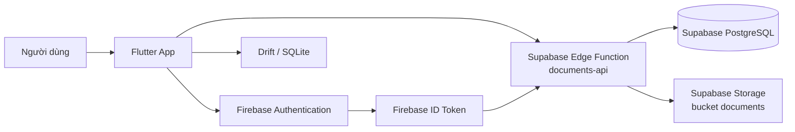

# Phát triển Hệ thống Quản lý Tài liệu Đa nền tảng với Flutter, Firebase và Supabase

## 1. Mục tiêu và phạm vi

Ứng dụng được xây dựng bằng Flutter nhằm quản lý tài liệu học tập trên nhiều thiết
bị. Người dùng đăng nhập bằng tài khoản Google thông qua Firebase Authentication,
còn dữ liệu quan hệ, quyền truy cập và tệp vật lý được quản lý trên Supabase.

Trọng tâm của bài tập gồm:

- Xác thực người dùng an toàn bằng Google/Firebase.
- Lưu trữ tài liệu và metadata trên Cloud.
- Phân quyền chủ sở hữu, người chỉnh sửa và người chỉ xem.
- Chia sẻ tài liệu bằng email nhưng chỉ chấp nhận tài khoản đã đăng nhập ứng dụng.
- Kiểm thử tính toàn vẹn dữ liệu trên nhiều tài khoản.

> **Lưu ý về lựa chọn dịch vụ:** Firebase được dùng cho Authentication. Tệp được
> lưu trong Supabase Storage thay vì Firebase Storage để phù hợp với gói miễn phí
> đang sử dụng. Supabase PostgreSQL lưu metadata và quyền chia sẻ.

## 2. Checklist triển khai

| STT | Hạng mục | Trạng thái |
|---:|---|---|
| 1 | Thiết lập Firebase và đăng nhập Google trong ứng dụng Flutter | Hoàn thành |
| 2 | Upload tệp vật lý lên Supabase Storage và liên kết với metadata tài liệu | Hoàn thành |
| 3 | Thiết kế các bảng Người dùng, Tài liệu và Quyền chia sẻ trên Supabase | Hoàn thành |
| 4 | Tìm kiếm, cập nhật và chia sẻ tài liệu bằng email | Hoàn thành |
| 5 | Thiết lập RLS và kiểm soát quyền qua Edge Function | Hoàn thành |
| 6 | Kiểm thử với tối thiểu ba tài khoản và các mức quyền khác nhau | Hoàn thành theo ma trận kiểm thử |

## 3. Kiến trúc hệ thống



### 3.1. Vai trò của từng thành phần

- **Flutter:** giao diện đăng nhập, danh sách, tìm kiếm, biểu mẫu, mở, sửa, xóa
  và chia sẻ tài liệu.
- **Firebase Authentication:** đăng nhập Google, quản lý phiên và cấp Firebase
  UID/ID token.
- **Supabase Edge Function `documents-api`:** xác minh Firebase ID token,
  đồng bộ người dùng, kiểm tra quyền và thực hiện các thao tác bảo mật với
  database/storage.
- **Supabase PostgreSQL:** lưu người dùng, metadata tài liệu và quyền chia sẻ.
- **Supabase Storage:** lưu tệp vật lý trong bucket riêng tư `documents`.
- **Drift/SQLite:** bộ nhớ đệm cục bộ để hiển thị nhanh danh sách tài liệu.

Client không sử dụng service role key. Các thao tác Cloud được gửi đến Edge
Function kèm Firebase ID token; service role key chỉ được lưu trong secrets của
Supabase.

## 4. Xác thực Google bằng Firebase

Luồng đăng nhập:

1. Người dùng chọn **Đăng nhập bằng Google**.
2. Firebase Authentication xác thực credential Google.
3. Firebase cấp Firebase UID và ID token.
4. Ứng dụng gửi token đến `documents-api`.
5. Edge Function xác minh token, sau đó tạo hoặc cập nhật bản ghi tương ứng
   trong bảng `users`.

Các tệp cấu hình Flutter chính:

```text
android/app/google-services.json
lib/firebase_options.dart
lib/services/auth_service.dart
```

Khởi chạy ứng dụng với Supabase publishable key:

```powershell
flutter pub get
flutter run -d emulator-5554 `
  --dart-define=SUPABASE_PUBLISHABLE_KEY=sb_publishable_...
```

Không đưa các secret sau vào ứng dụng Flutter:

- `SUPABASE_SERVICE_ROLE_KEY`
- Firebase service-account private key
- Database password hoặc URL kết nối quản trị

## 5. Thiết kế cơ sở dữ liệu Supabase

### 5.1. Bảng `users`

Lưu thông tin tài khoản Firebase đã đăng nhập ứng dụng.

| Trường | Kiểu | Ý nghĩa |
|---|---|---|
| `id` | `text` | Firebase UID, khóa chính |
| `email` | `text` | Email tài khoản |
| `display_name` | `text` | Tên hiển thị |
| `avatar_url` | `text` | Ảnh đại diện |
| `created_at` | `timestamptz` | Thời điểm tạo |
| `updated_at` | `timestamptz` | Thời điểm cập nhật |

### 5.2. Bảng `documents`

Lưu metadata và quan hệ sở hữu của tài liệu.

| Trường | Kiểu | Ý nghĩa |
|---|---|---|
| `id` | `uuid` | Khóa chính của tài liệu |
| `owner_id` | `text` | Firebase UID của chủ sở hữu |
| `title` | `text` | Tiêu đề |
| `description` | `text` | Mô tả |
| `type` | `text` | Loại tài liệu |
| `storage_path` | `text` | Đường dẫn trong bucket `documents` |
| `file_name` | `text` | Tên tệp |
| `mime_type` | `text` | Kiểu MIME |
| `size_bytes` | `bigint` | Kích thước tệp |
| `created_at` | `timestamptz` | Thời điểm tạo |
| `updated_at` | `timestamptz` | Thời điểm cập nhật |

Đường dẫn tệp có dạng:

```text
<owner_firebase_uid>/<document_id>/<file_name>
```

### 5.3. Bảng `document_permissions`

Lưu quyền chia sẻ giữa tài liệu và người dùng.

| Trường | Kiểu | Ý nghĩa |
|---|---|---|
| `document_id` | `uuid` | Tài liệu được chia sẻ |
| `user_id` | `text` | Firebase UID người nhận |
| `permission` | `text` | `viewer` hoặc `editor` |
| `created_at` | `timestamptz` | Thời điểm cấp quyền |

Khóa duy nhất của bảng là cặp `document_id`, `user_id`, nhờ đó việc chia sẻ
lại sẽ cập nhật quyền thay vì tạo bản ghi trùng.

Email chỉ dùng để tìm người nhận trong `users`; hệ thống vẫn lưu Firebase UID
để phân quyền ổn định. Nếu email chưa từng đăng nhập ứng dụng, thao tác chia sẻ
bị từ chối.

## 6. Chức năng nghiệp vụ

### 6.1. Thêm và cập nhật tài liệu

1. Người dùng nhập tiêu đề, mô tả, loại tài liệu và chọn tệp.
2. Ứng dụng gửi tệp đến Edge Function dưới dạng dữ liệu mã hóa Base64.
3. Edge Function lưu tệp vào bucket riêng tư trên Supabase Storage.
4. Edge Function lưu hoặc cập nhật metadata trong `documents`.
5. Ứng dụng cập nhật Drift cache.

Giới hạn hiện tại của ứng dụng là tệp tối đa 10 MB. Khi xem tài liệu, Edge
Function tạo signed URL có thời hạn 15 phút; client không công khai bucket.

### 6.2. Tìm kiếm và xem tài liệu

Danh sách gồm tài liệu do người dùng sở hữu và tài liệu được chia sẻ. Có thể
tìm kiếm theo tiêu đề, mô tả và tên tệp. Người dùng chỉ nhận được signed URL
khi đã vượt qua kiểm tra quyền.

### 6.3. Phân quyền

| Quyền | Xem | Cập nhật | Xóa | Chia sẻ |
|---|:---:|:---:|:---:|:---:|
| Chủ sở hữu | Có | Có | Có | Có |
| `editor` | Có | Có | Có | Có |
| `viewer` | Có | Không | Không | Không |

Editor không trở thành chủ sở hữu. `owner_id` của tài liệu luôn được giữ
nguyên; khi editor upload tệp mới, tệp vẫn được lưu theo thư mục của chủ sở
hữu.

## 7. Bảo mật và RLS

RLS được bật trên các bảng `users`, `documents` và `document_permissions`.
Quyền truy cập trực tiếp của các role client `anon` và `authenticated` bị
thu hồi. Vì Firebase UID không phải Supabase Auth UID, việc xác thực token
Firebase và kiểm tra quyền được thực hiện trong Edge Function.

Edge Function thực hiện các bước:

1. Đọc Firebase ID token từ header.
2. Xác minh chữ ký, issuer, audience và subject của token.
3. Đồng bộ người dùng vào bảng `users`.
4. Kiểm tra `owner_id` hoặc bản ghi trong `document_permissions`.
5. Chỉ thực hiện thao tác tương ứng với quyền được cấp.

Bucket `documents` là private. Chỉ Edge Function có service role mới thao tác
trực tiếp với Storage; ứng dụng nhận signed URL ngắn hạn sau khi kiểm tra quyền.

## 8. Kiểm thử với ba tài khoản

Ma trận kiểm thử sử dụng ba tài khoản Firebase đã đăng nhập:

| Tài khoản | Vai trò | Kết quả cần xác minh |
|---|---|---|
| A | Chủ sở hữu | Tạo, xem, cập nhật, xóa và chia sẻ tài liệu |
| B | `viewer` | Xem tài liệu được chia sẻ; không cập nhật, xóa hoặc chia sẻ |
| C | `editor` | Xem, cập nhật, thay tệp, xóa và chia sẻ theo quyền editor |

Các trường hợp kiểm thử bổ sung:

- A chia sẻ bằng email của B với quyền `viewer`.
- A chia sẻ bằng email của C với quyền `editor`.
- Nhập email chưa từng đăng nhập: hệ thống từ chối với thông báo tài khoản
  phải đăng nhập trước.
- B thử cập nhật/xóa/chia sẻ: API trả về lỗi thiếu quyền.
- C cập nhật metadata và tệp: bản ghi vẫn giữ `owner_id` của A.
- Người không có quyền không thể nhận signed URL của tài liệu.
- Chia sẻ lại cùng một email cập nhật quyền, không tạo bản ghi trùng.

Lệnh kiểm tra mã nguồn:

```powershell
flutter analyze
flutter test
npx supabase db push
npx supabase functions deploy documents-api --no-verify-jwt
```

## 9. Cấu trúc mã nguồn liên quan

```text
lib/
├── main.dart
├── pages/
│   ├── document_list_page.dart
│   └── document_form_page.dart
├── repositories/
│   └── document_repository.dart
└── services/
    ├── auth_service.dart
    └── storage_service.dart

supabase/
├── functions/documents-api/index.ts
├── migrations/
└── DEPLOYMENT.md
```

## 10. Kết luận

Giải pháp kết hợp Firebase Authentication với Supabase tạo thành kiến trúc
phù hợp cho ứng dụng Flutter: Firebase đảm nhiệm đăng nhập Google, Supabase
đảm nhiệm cơ sở dữ liệu quan hệ, phân quyền và lưu trữ tệp. Việc đưa toàn bộ
thao tác bảo vệ vào Edge Function giúp giữ kín khóa quản trị, kiểm soát quyền
theo Firebase UID và hỗ trợ chia sẻ tài liệu an toàn giữa nhiều người dùng.

Kết quả đáp ứng sáu mục tiêu của bài tập: xác thực Google, lưu tệp Cloud,
thiết kế database quan hệ, tìm kiếm/cập nhật/chia sẻ, bảo vệ bằng RLS và kiểm
thử trên nhiều tài khoản với các mức quyền khác nhau.
